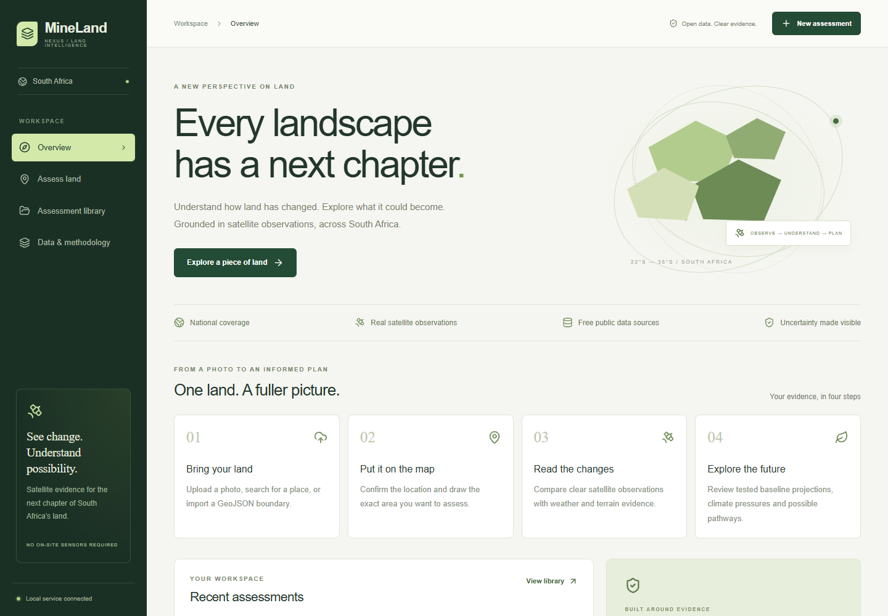
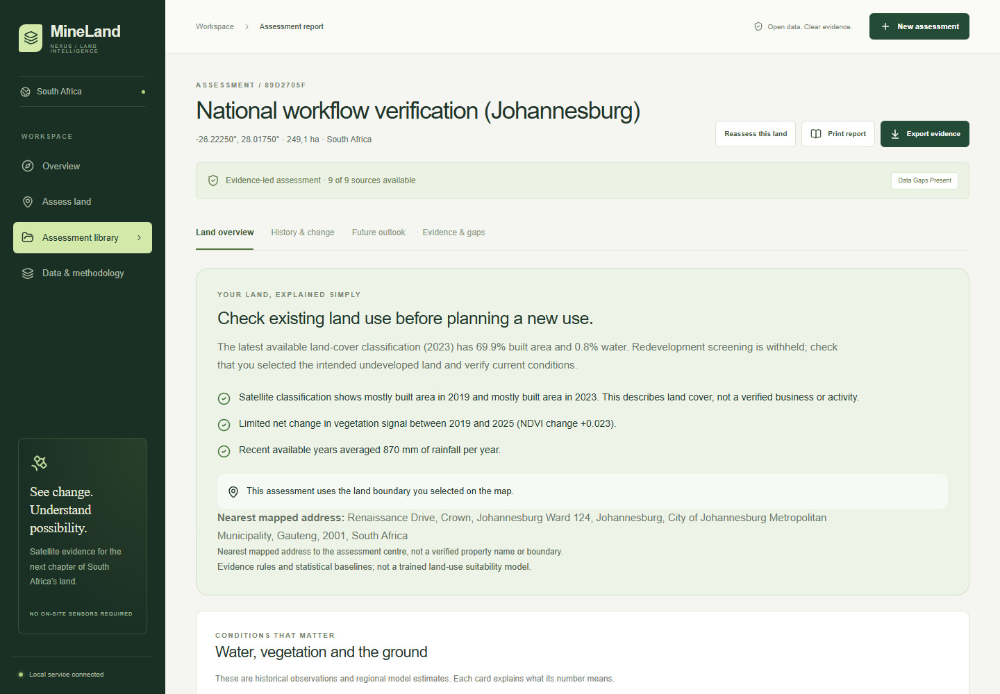
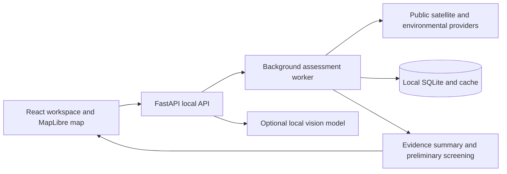

<div align="center">

# MineLand Nexus

**Understand the land. See the evidence. Plan its next chapter.**

Local land intelligence for South Africa, combining public satellite data, environmental history and understandable recommendations.

[](https://github.com/Menzi-dev/mineland-nexus/actions/workflows/ci.yml)


[Quick start](#quick-start) | [How it works](#how-it-works) | [Local photo AI](#local-photo-ai) | [Testing](#testing) | [Troubleshooting](#troubleshooting)

</div>



## What this project does

MineLand Nexus helps you investigate a user-confirmed piece of land anywhere within mainland South Africa. Start with a photo, search for a place, enter coordinates, select a small plot on the map, or import a GeoJSON boundary. The same assessment pipeline researches the selected area and explains the results in plain language.

The application runs locally. The active workflow needs no physical sensors, paid API keys, PostgreSQL or cloud account. Public datasets and map tiles require internet access, and their usage terms still apply.

| Question | What you receive |
| --- | --- |
| Where is the land? | Photo GPS when present, place search, nearest mapped address and a boundary you confirm on the map. |
| What does the photograph show? | Optional local AI descriptions of visible features, clearly marked as unverified. |
| How has the land changed? | Dated satellite observations, annual classified land-cover history and linked public background about nearby places. |
| What are the environmental conditions? | Vegetation, vegetation moisture, modelled soil moisture, rainfall, temperature, sunlight, terrain and reference climatic water balance. |
| What could it become? | Preliminary solar/restoration comparisons with reasons, risks and next actions; other possible uses with their missing evidence requirements. |
| Can I review the evidence? | Source links, retrieval timestamps, data gaps, report printing and a JSON evidence export. |

> A small untagged land photograph cannot reliably establish an exact location. Satellite classifications do not establish ownership or abandonment. MineLand Nexus makes those unknowns visible rather than inventing answers.

## Quick start

### Requirements

- **Python 3.11 or newer** with compatible wheels for the listed geospatial packages. The local Windows workflow has been tested with Python 3.14.
- **Node.js 22.12+**; Node 24 is used in CI.
- Internet access for public providers and map tiles.
- Windows PowerShell for the convenience launchers. Manual startup is also available on Linux and macOS.

### Windows

```powershell
git clone https://github.com/Menzi-dev/mineland-nexus.git
cd mineland-nexus

python -m venv .venv-sa
.\.venv-sa\Scripts\python.exe -m pip install -r backend/requirements-national.txt
npm.cmd --prefix frontend ci

.\Open-MineLand.cmd
```

The launcher starts the API and interface in the background and opens the application. On later visits, double-click **`Open-MineLand.cmd`**. It uses `.venv-sa` when available and otherwise uses system Python. Logs are written to `artifacts/`.

| Service | Local address |
| --- | --- |
| Application | http://127.0.0.1:5173 |
| API documentation | http://127.0.0.1:8000/docs |
| API health | http://127.0.0.1:8000/health |
| Local photo AI, if installed | http://127.0.0.1:11435/health |

The attributed country boundary is bundled. To refresh it from geoBoundaries:

```powershell
.\.venv-sa\Scripts\python.exe backend/bootstrap_data.py
```

### Manual startup

On Windows, run these in separate terminals:

```powershell
powershell -ExecutionPolicy Bypass -File .\start-backend.ps1
```

```powershell
.\start-frontend.cmd
```

On Linux or macOS, create and activate a Python environment, then start the API:

```bash
python3 -m venv .venv-sa
source .venv-sa/bin/activate
python -m pip install -r backend/requirements-national.txt
python -m uvicorn app.main:app --app-dir backend --host 127.0.0.1 --port 8000
```

In a second terminal:

```bash
npm --prefix frontend ci
npm --prefix frontend run dev -- --host 127.0.0.1
```

If the country-boundary file is missing, run `python backend/bootstrap_data.py` in the activated environment before starting the API. Keep services bound to loopback for local use.

## How it works

1. **Locate the land.** Upload a JPEG, PNG or WebP, search a place, enter coordinates, or import one GeoJSON Polygon/MultiPolygon. Original photo files are limited to 10 MB and 40 megapixels.
2. **Select the assessment boundary.** Draw around the land, choose a 4-hectare small plot, or use the approximate 1 km2 square at the map centre. Supported areas are 1-2,500 hectares, wholly within mainland South Africa. These are assessment extents, not detected cadastral parcels.
3. **Confirm the details.** Enter a recognisable assessment name. Keep or adjust the history years, three-month comparison season and outlook horizon. An optional farm/erf reference and site notes are stored as unverified user information.
4. **Start the assessment.** The application checks your inputs and queues a background job. If something needs correction, the reason appears beside the Start button. Processing can take several minutes, especially for uncached satellite imagery.
5. **Read the report.** Review the plain-language summary, environmental indicators, map, history, future-use options, reasons, risks and missing evidence. Export the full record as JSON or print the current report view.

Changing the selected location or boundary clears confirmation. Photo GPS locates the camera, which can be outside the photographed land. Reports warn when GPS lies outside the selected boundary. Without GPS, the photo-to-land match depends on your map confirmation.

For an older report, choose **Reassess this land** to review the boundary and retrieve the current set of sources.

### A report you can read



*Screenshots demonstrate the interface. Example assessments are engineering checks, not claims that the pictured land is abandoned or available for development.*

The report separates:

- **Evidence:** retrieved observations, classifications, units and source dates.
- **Interpretation:** what a vegetation change, climate signal or land-cover class can reasonably suggest.
- **Possible actions:** a study priority, the reasons behind it and checks before proceeding.
- **Unknowns:** missing provider years, soil safety, water rights, ownership, exact activity history and permissions.

## Environmental evidence

| Layer | Source | What to keep in mind |
| --- | --- | --- |
| Vegetation and surface signals | Sentinel-2 L2A / Element 84 Earth Search | Up to three distinct clear acquisition dates per year in the same three-month season. At least 70% usable land coverage per accepted scene. |
| Rainfall, temperature, sunlight and reference water demand | ECMWF ERA5 via Open-Meteo | Regional reanalysis, approximately 25 km; not sensors on the plot. |
| Surface soil moisture | ERA5-Land via Open-Meteo | Approximately 11 km model grid. The top 0-7 cm is reported as water by volume, not relative saturation or irrigation advice. |
| Future climate | Two CMIP6 HighResMIP models via Open-Meteo | Decadal climate comparisons, not weather forecasts for a particular future year. |
| Terrain | Copernicus DEM GLO-30 | Elevation and approximate slope; not an engineering survey. |
| Historical land cover | Impact Observatory / Esri / Microsoft annual 10 m classification | Product coverage is limited. Missing years remain missing. A class is not proof of a dated human activity. |
| Place and mapped land use | OpenStreetMap, Nominatim and Overpass | Volunteer-map context, not verified property identity or title records. |
| Nearby public background | Wikipedia geosearch | Linked, attributed excerpts within 10 km, labelled as nearby-area context rather than parcel history. |

See [data sources, methods and attribution](docs/DATA_SOURCES.md) for the full interpretation and provider links.

### Forecasts and recommendations

Vegetation forecasting needs at least five usable same-season years. A linear NDVI trend competes with a persistence baseline using rolling-origin historical errors. The lower-error baseline is projected with an approximate uncertainty band. This is a transparent baseline, **not a validated national land-use prediction model**.

Solar and ecological-restoration scores use declared preliminary formulas. They are study priorities among the supported comparisons, not probabilities or proof of the best use. Built/water cover can withhold redevelopment scoring. Solar scoring is withheld above a 15-degree median slope. Low potential, drought pressure and steep-ground risks remain visible even when an option ranks first.

Agriculture, grazing, community use and reuse of developed land appear as conditional possibilities with specific soil, water, tenure, infrastructure and planning evidence requirements. Climate changes are reported separately from the vegetation baseline; no trained climate-to-vegetation relationship is claimed.

## Local photo AI

The optional photo assistant runs **SmolVLM-256M** through a project-local **llama.cpp** CPU runtime. Images are processed on your computer. Descriptions can miss or misdescribe details and are never treated as coordinates, ownership evidence or suitability scores.

### Install on Windows

Using the project Python environment:

```powershell
.\.venv-sa\Scripts\python.exe backend/setup_local_vision.py
.\start-local-ai.ps1
```

Setup downloads about **305 MB** from the official runtime and model repositories, verifies SHA-256 checksums and records the model revision. The files stay in ignored `.local-ai/`; they are not stored in GitHub. The Windows launcher starts the assistant automatically when installed.

Photos are analysed automatically when the local assistant is ready. The interface shows whether it is configured, and GPS/map assessment still works when AI is unavailable. Check readiness at `/api/ai/status`.

### Optional Ollama alternative

Use an installed Ollama vision model, leave the project-local assistant stopped, set `MINELAND_VISION_MODEL` to the installed model name, and restart the backend. The application uses Ollama on loopback port 11434. No paid AI key is required.

References: [model files and licence](https://huggingface.co/ggml-org/SmolVLM-256M-Instruct-GGUF) | [pinned CPU runtime release](https://github.com/ggml-org/llama.cpp/releases/tag/b12138) | [Ollama API](https://docs.ollama.com/api/chat).

## Architecture



```text
backend/
  app/main.py                 Active FastAPI entry point
  app/national/
    router.py                 Upload, location, assessment and export APIs
    geometry.py               Country extent and boundary validation
    providers.py              Public-data retrieval and caching
    engine.py                 Background assessment orchestration
    analysis.py               Forecasting and screening formulas
    insights.py               Plain-language report and photo-location checks
    local_ai.py               Local vision integrations
    store.py                  SQLite persistence and restart recovery
  tests/test_national.py      Offline regression suite
  bootstrap_data.py           Attributed country-boundary refresh
  setup_local_vision.py       Verified local model/runtime download
frontend/
  src/App.jsx                Workspace, form and job progress
  src/components/            Map, report, explanation and location views
  browser-check.mjs          Desktop/mobile workflow checks
  photo-workflow-check.mjs    Photo AI through real report/export
  start-assessment-check.mjs  Validation rejection and successful retry
```

Historical prototype modules and `docker-compose.yml` remain for reference. They are not used by `app.main:app`. The active application uses SQLite and the national requirements file, not the legacy PostgreSQL/MinIO setup.

## Testing

### Offline regression suite

```powershell
.\.venv-sa\Scripts\python.exe -m pip install -r backend/requirements-dev.txt
.\.venv-sa\Scripts\python.exe backend/tests/test_national.py
```

The suite covers geometry, photo GPS, confirmation, persistence, temporal backtesting, missing data, photo-location mismatch, moisture interpretation and screening constraints. It uses temporary storage and mocked providers.

### Frontend build

```shell
npm --prefix frontend ci
npm --prefix frontend run build
```

### Browser and live-provider checks

With the API and frontend running, and Microsoft Edge installed:

```shell
cd frontend
node browser-check.mjs
node start-assessment-check.mjs
node photo-workflow-check.mjs
```

The photo workflow check additionally requires the local vision assistant and an existing completed/partial Johannesburg workflow-verification record. Create that record first from the project root:

```shell
python backend/check_workflow.py
```

Live checks use real public services and save labelled verification records. They can take several minutes or expose provider outages; they are separate from offline CI. Browser screenshots and exported test reports go to ignored `artifacts/`.

**Last local verification:** 31 regression tests, production build, desktop/mobile checks, rejected-input recovery and live photo-to-report workflow passed. [GitHub Actions](https://github.com/Menzi-dev/mineland-nexus/actions) runs the backend suite and frontend build for pushes and pull requests. See [verification notes](VERIFICATION.md) for scope and limitations.

## Troubleshooting

| Symptom | What to do |
| --- | --- |
| Start assessment does not proceed | Read the message beside the button. Enter a name, select a valid 1-2,500 ha boundary, confirm it, and choose at least five complete historical years. A photo or searched address alone does not define an assessment area. |
| Local API cannot be reached | Run `start-backend.ps1` or the manual API command. Check `http://127.0.0.1:8000/health` and `artifacts/backend.stderr.log`. |
| Missing dependencies | Install `backend/requirements-national.txt` in `.venv-sa`, then run `npm --prefix frontend ci`. Do not use an old virtual environment that points to a missing interpreter. |
| Map background is blank | Check internet access, try the other map layer and allow map-provider requests. A dated analytical overlay and the basemap have different sources and dates. |
| Assessment finishes with data gaps | Open Evidence & gaps. Clouds, missing product years, rate limits and provider failures are explicit; missing evidence is not replaced by invented values. |
| Local photo AI is unavailable | Check `/api/ai/status`, run `start-local-ai.ps1` after installation and inspect `artifacts/vision.stderr.log`. Map/GPS assessment remains available. |
| Job was interrupted | A backend restart marks queued/running work interrupted. Reopen it from the library, review the boundary and rerun. Completed reports stay saved. |
| Location is wrong or unknown | Check GPS against the map. Without usable photo GPS, locate the land with a known place, coordinates or a boundary; a small untagged photo has no guaranteed location match. |

## Privacy, deployment and limitations

Photos, extracted GPS, notes and reports are stored locally. Preview images are saved without EXIF, but extracted GPS can remain in the SQLite record. Public provider requests disclose the selected coordinates/extent, and the browser fetches external map tiles. This is not a fully offline application.

Runtime data lives under `backend/data/national/`; model/runtime files live in `.local-ai/`. Both personal runtime content and generated outputs are excluded from Git. Back up your local data folder if you need to retain assessments. See [SECURITY.md](SECURITY.md).

The application does **not** establish exact ownership, previous owners, abandonment, closure reasons, contamination, water rights, protected status or permission to develop. There is no connected title registry. The ownership panel links to the [official Deeds Registry information process](https://www.gov.za/services/services-residents/place-live/get-deeds-registry-information).

This is a local single-user research application. Public multi-user hosting requires authentication, isolated records, durable workers, storage quotas, monitoring and an independent security/scientific review.

## Contributing and project rights

Bug reports and focused improvements are welcome. Read [CONTRIBUTING.md](CONTRIBUTING.md) and use the issue/PR templates. Do not attach private photos, coordinates or credentials to public issues.

No source-code licence has been selected by the repository owner. Public visibility alone does not grant permission to reuse the application code. Dataset, imagery, model and runtime rights are governed separately by their respective licences.

Open-Meteo's free hosted endpoints are for **non-commercial** use. Review all [data-source terms and attribution](docs/DATA_SOURCES.md) before commercial use or redistribution.
